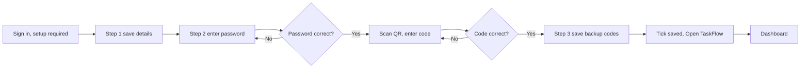
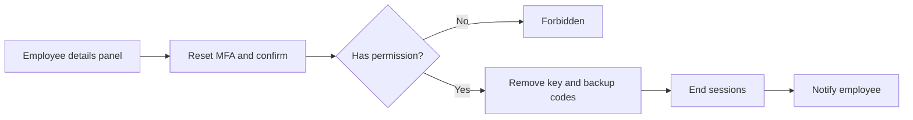

# MFA Security Setup – Functional Workflow

> **Project:** TaskFlow – Intelligent Task Allocation & Tracking System
> **Parent Module:** Authentication  ·  **Child Module:** 01.3 MFA Security Setup
> **Version:** 1.0  ·  **Last Updated:** 31-Oct-2026
> **Author:** Jojo George (jojogeorge3344@gmail.com)
> © 2026 Jojo George. All rights reserved.

---

## 1. Overview
MFA Security Setup is the mandatory first stop for every user who has not yet set up two-step verification. The user confirms their details, connects an authenticator app and saves ten one-time backup codes; until this is done the rest of TaskFlow stays closed. This child module also covers the administrator action that removes an employee's authenticator when they lost their phone.

## 2. Purpose / Business Value
- A stolen password alone is not enough: every user must set up an authenticator app before they can use the application (two-step verification is required by default).
- Users confirm their name, email and mobile number once, before the account is secured.
- Backup codes give the user a way in if the phone is not at hand.
- An administrator can help a user who lost their phone and their backup codes; the reset ends all of that user's sessions.

## 3. Who Can Access

| Role          | Can See | Can Use | Access Level (Own / Team / Organization) |
|---------------|:-------:|:-------:|------------------------------------------|
| Administrator | ✅ | ✅ | Own (own setup); Organization for "Reset two-step verification" of another employee |
| Manager       | ✅ | ✅ | Own |
| Employee      | ✅ | ✅ | Own |
| Custom Role   | ✅ | ✅ | Own; "Reset two-step verification" only if granted (Configurable) |

The Security Setup screen is shown only to signed-in users who still have to set up two-step verification; anyone else is sent to their dashboard. The reset action is reached from Employee Management, so it also needs access to the employee list (the permission matrix notes that `employees.mfa.reset` requires `employees.view`).

## 4. Screens

| # | Screen Name | Menu Path | Purpose | Visible To |
|---|-------------|-----------|---------|------------|
| 1 | Let's secure your account (Security Setup) | Opens automatically after sign-in (`/security-setup`) | Confirm your details, connect an authenticator app, save backup codes | Signed-in users who have not set up two-step verification yet |
| 2 | Employee details panel – **Reset MFA** button | Management → Employee Management → employee row → details panel | Remove an employee's authenticator and backup codes and end their sessions | Users with `employees.mfa.reset`, for employees whose two-step verification is on |

---

## 5. Screen & Functionality Details

### 5.1 Screen: Let's secure your account (Security Setup)
**Purpose:** First stop for every user who has not set up two-step verification: confirm their details, connect an authenticator app and save backup codes. Until this is done the rest of TaskFlow (screens and API) stays closed.
**Who can see this screen:** Signed-in users who still have to set up two-step verification (anyone else is sent to their dashboard).
**Required permission:** `profile.mfa.manage` (Always On); step 1 uses `profile.view` and `profile.edit` (Always On).

**Screen Elements**
- Left panel: TaskFlow brand, heading *"Let's secure your account"*, a three-step progress list (**Your details**, **Authenticator app**, **Backup codes**) and three benefits.
- Mobile progress bar *"Step N of 3"*.
- Step 1 – Your details: avatar and *"Welcome, (first name)"*, read-only facts (Employee code, Username, Role, Projects, Managers), **Full name**, **Email** (name part, fixed `@taskflow.com` suffix), **Mobile number**, **Sign out** and **Save and continue** buttons.
- Step 2 – Authenticator app: **Current password** with **Show/Hide**, **Back** and **Show my QR code** buttons; then the QR code, instructions, the typed key with **Copy key**, the **6-digit code** field, **Start over** and **Verify and turn on** buttons.
- Step 3 – Backup codes: title *"Two-step verification is on"*, list of 10 backup codes, **Copy all**, **Download**, the check box *"I have saved my backup codes somewhere safe."* and **Open TaskFlow** (enabled only after ticking).
- Loading skeleton and an error box *"We could not load your details."* with **Try again**.

**Employee details panel (administrator reset)** – in Employee Management the details panel shows a **Two-step** fact (*"On (authenticator app)"* or *"Off"*) and, for users with `employees.mfa.reset` when the employee's two-step verification is on, a **Reset MFA** button that opens the confirmation *"Reset two-step verification?"*.

### 5.2 Functionalities

| # | Functionality | Purpose | Who Can See | Who Can Use | Permission Required | Scope |
|---|---------------|---------|-------------|-------------|---------------------|-------|
| 1 | Confirm my details | Check name, email and mobile number before the account is secured | Users with setup pending | Same | `profile.view`, `profile.edit` (Always On) | Own |
| 2 | Start authenticator setup | Re-enter current password and get a new key and QR code | Users with setup pending | Same | `profile.mfa.manage` (Always On) | Own |
| 3 | Copy key | Copy the setup key when the QR code cannot be scanned | Users on step 2 | Same | `profile.mfa.manage` (Always On) | Own |
| 4 | Verify and turn on | Confirm the first 6-digit code; two-step verification turns on and backup codes are created | Users on step 2 | Same | `profile.mfa.manage` (Always On) | Own |
| 5 | Copy / Download backup codes | Keep the 10 one-time backup codes safe (shown only once) | Users on step 3 | Same | `profile.mfa.manage` (Always On) | Own |
| 6 | Open TaskFlow | Finish setup and go to the dashboard | Users on step 3 | Same | None | Own |
| 7 | Sign out | Leave without finishing setup | Users with setup pending | Same | None | Own |
| 8 | Regenerate backup codes | Replace the backup codes (old set stops working); needs current password and a code | – (no screen found) | Any signed-in user with two-step verification on, via the API | `profile.mfa.manage` (Always On) | Own |
| 9 | Check a code | Check a code without using it up (used by Profile before showing a typed password) | Profile screen | Any signed-in user with two-step verification on | `profile.mfa.manage` (Always On) | Own |
| 10 | Reset two-step verification of an employee | Remove someone's authenticator and backup codes when they lost their phone; ends their sessions | Users with the permission (Employee Management) | Administrator (Granted); custom roles if granted | `employees.mfa.reset` | Organization |

> ⚠️ To be confirmed: "Regenerate backup codes" has an API but no screen was found in `modules/auth` (the permission audit also reports no UI for it).

### 5.3 Step-by-Step Workflow – First-time security setup
1. User signs in. Because two-step verification is required and not set up, TaskFlow opens **Let's secure your account**. Any other page or API call is refused until setup is finished.
2. **Step 1 – Your details:** user checks **Full name**, **Email** and **Mobile number** and clicks **Save and continue**. The system validates and saves the details.
3. **Step 2 – Authenticator app:** user types their **Current password** and clicks **Show my QR code**. The system checks the password and returns a new key and QR code (two-step verification is still off at this point).
4. User scans the QR code (or types the key) in an authenticator app such as Google Authenticator, Microsoft Authenticator or Authy, enters the 6-digit code and clicks **Verify and turn on**.
5. The system checks the code. If correct, two-step verification turns on and 10 backup codes are created.
6. **Step 3 – Backup codes:** user copies or downloads the codes, ticks *"I have saved my backup codes somewhere safe."* and clicks **Open TaskFlow**.
7. The user is taken to their dashboard. From now on every sign-in asks for the code.

**Flow Diagram**

### 5.4 Step-by-Step Workflow – Administrator resets an employee's two-step verification
1. Administrator opens **Employee Management** and the employee's details panel.
2. Administrator clicks **Reset MFA** (shown only with `employees.mfa.reset` and when the employee has two-step verification on) and confirms the dialog *"Reset two-step verification?"* (confirm button **Reset MFA**).
3. The system removes the employee's key and backup codes, ends all of the employee's sessions and sends them the notification *"An administrator reset your authenticator MFA. Sign in with your password and set it up again from Profile."*
4. The panel shows *"MFA reset for (employee name)"* and the employee's two-step status changes to **Off**.
5. On the next sign-in the employee is sent to **Security Setup** again.

**Flow Diagram**

### 5.5 Business Rules & Validations
- Two-step verification is required for everyone by default (`Mfa:Required` = true); it can be switched off only as a break-glass measure in server configuration.
- While setup is pending, the server answers every request with *"Set up two-step verification to continue."* except sign-in endpoints, the user's own profile (`/users/me`) and the MFA setup endpoints.
- Starting setup needs the current password; wrong password → *"Current password is incorrect."* Re-entering the password is limited (5 attempts per 5 minutes) → *"Too many attempts. Try again in a few minutes."*
- Setup cannot be started again once two-step verification is on (*"Authenticator MFA is already on. Turn it off first to set it up again."*).
- Turning on needs a key first (*"Start the setup first to get a key."*) and a correct 6-digit code; backup codes are not accepted for turning on.
- Exactly 10 backup codes are created, in the form `XXXXX-XXXXX`; each works once and they are shown only once.
- The setup key is stored encrypted; backup codes are stored only as hashes.
- Wrong codes count toward the shared lockout: 5 wrong codes lock code checks for 5 minutes.
- Details: full name required (max 200); email must use the `@taskflow.com` domain and be unique; mobile number required on this screen and in international format.
- **Open TaskFlow** stays disabled until the user confirms they saved the backup codes.
- The administrator reset is offered only for employees whose two-step verification is on, and it ends all of that employee's sessions.

### 5.6 Messages Shown to the User

| Situation | Message |
|-----------|---------|
| Full name empty | Enter your full name. |
| Email name part invalid | Use letters, digits, dot, underscore or hyphen before @taskflow.com. |
| Email invalid (server) | Email must be a name using letters, digits, dot, underscore or hyphen followed by @taskflow.com. |
| Email in use | Email already exists. |
| Same email and mobile exist | A user with this email and mobile number already exists. |
| Mobile number empty | Enter your mobile number. |
| Mobile number format | Use international format, for example +919876543210. |
| Details not saved (no server message) | Could not save your details. Please try again. |
| Details could not load | We could not load your details. |
| Password empty | Enter your password. |
| Wrong password | Current password is incorrect. |
| Too many password attempts | Too many attempts. Try again in a few minutes. |
| Setup failed (no server message) | Could not start setup. Please try again. |
| Code missing or not 6 digits | Enter the 6-digit code from the app. |
| Wrong code | The code is incorrect or has expired. |
| Code lockout | Too many wrong codes. Try again in a few minutes. |
| Code failed (no server message) | That code did not work. Check the app and try the new code. |
| Already on | Authenticator MFA is already on. Turn it off first to set it up again. |
| Key copied / codes copied | Key copied / Backup codes copied |
| Copy failed | Could not copy. Select the text and copy it by hand. |
| Any other page while setup pending | Set up two-step verification to continue. |
| Administrator reset – confirmation | Reset two-step verification? (employee name) will be signed out everywhere and can sign in with just their password. They can set up an authenticator app again from Profile. |
| Administrator reset – success | MFA reset for (employee name) |
| Administrator reset – failed (no server message) | Could not reset MFA. |
| Notification after admin reset | An administrator reset your authenticator MFA. Sign in with your password and set it up again from Profile. |
| No permission (administrator reset) | The API answers 403 Forbidden; the button is hidden without `employees.mfa.reset`. No specific message text exists in code. |

> ⚠️ To be confirmed: the reset confirmation says the employee "can sign in with just their password", but while `Mfa:Required` is true the employee is sent to Security Setup on the next sign-in (and the text points to Profile, while setup happens on `/security-setup`).

---

## 6. Permission Summary

| Permission Key | Description | Administrator | Manager | Employee | Custom Role |
|----------------|-------------|:-------------:|:-------:|:--------:|:-----------:|
| `profile.view` | View my profile (used by Security Setup step 1 to load details) | Always On | Always On | Always On | Always On |
| `profile.edit` | Edit my personal information (Security Setup step 1) | Always On | Always On | Always On | Always On |
| `profile.mfa.manage` | Manage my authenticator: set up two-step verification and regenerate backup codes | Always On | Always On | Always On | Always On |
| `employees.mfa.reset` | Reset two-step verification of an employee (Employee Management) | Granted | Denied | Denied | Configurable |

## 7. Related Modules
- **01.1 Login** – users with setup pending are sent here after sign-in; once two-step verification is on, every sign-in asks for the code.
- **01.2 Account Recovery** – self-service password reset works only after two-step verification has been set up here.
- **01.4 Sessions and Tokens** – the session check sends users with setup pending back here; the administrator reset ends all of the employee's sessions.
- **Profile** – the user's own details and MFA endpoints live under `/users/me`; Profile also uses the code check before showing a typed password.
- **Management (Employee Management)** – hosts the **Reset MFA** button in the employee details panel.
- **Communication (Notifications)** – a system notification is sent after an administrator MFA reset.
- **Dashboard** – **Open TaskFlow** finishes setup and opens the user's dashboard.

## 8. Expected Outcome
No one can use TaskFlow until their account is protected by an authenticator app and backup codes, and an administrator can safely help a user who lost their phone, with all of that user's old sessions ended immediately.

---
© 2026 Jojo George. All rights reserved. Unauthorized copying or distribution of this document is prohibited.
