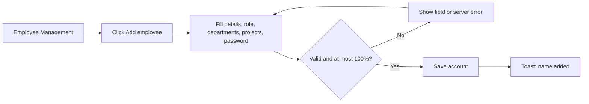
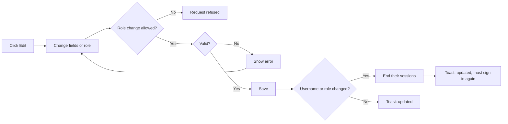
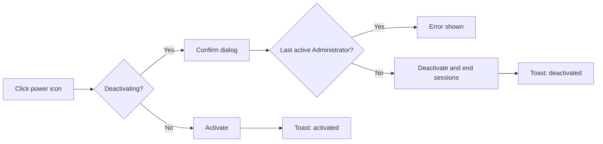
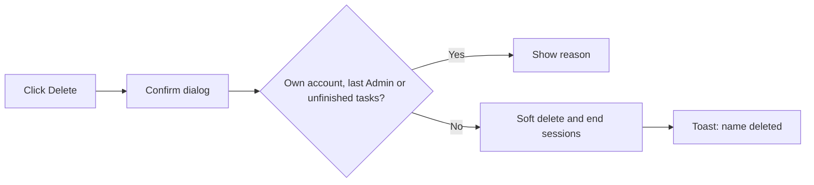
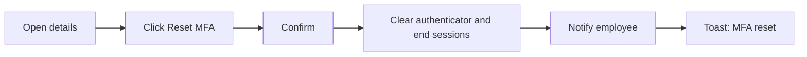

# Employee Management – Functional Workflow

> **Project:** TaskFlow – Intelligent Task Allocation & Tracking System
> **Parent Module:** Management  ·  **Child Module:** 03.1 Employee Management
> **Version:** 1.0  ·  **Last Updated:** 31-Oct-2026
> **Author:** Jojo George (jojogeorge3344@gmail.com)
> © 2026 Jojo George. All rights reserved.

---

## 1. Overview
Employee Management (menu **TaskFlow Management → Employee Management**) is where administrators keep the list of people who use TaskFlow. Each employee is a sign-in account with a role, departments and project allocations. Here an administrator adds people, edits them, switches accounts on or off, removes people who have left and resets lost two-step verification.

## 2. Purpose / Business Value
- Gives administrators one place to create sign-in accounts, give roles, switch accounts on or off and remove people who have left.
- Shows each person's projects, departments and managers in one place. Managers are worked out from departments and projects, so no one keeps a separate "reports to" list.
- Protects the system. The last active Administrator cannot be removed, nobody can delete their own account, and anyone whose username or role changes, or who is deactivated, is signed out straight away.
- Keeps history. Deleting a person hides them but keeps their tasks, comments and mail.

## 3. Who Can Access This Child Module

| Role          | Can See Screen | Can Use Screen | Access Level (Own / Team / Organization) |
|---------------|:--------------:|:--------------:|------------------------------------------|
| Administrator | ✅ | ✅ | Organization |
| Manager       | ❌ (menu hidden, `/employees` redirects) | Only through other screens (for example the task assignee picker), using `employees.view` | Organization (no team limit on the list) |
| Employee      | ❌ | ❌ | – |
| Custom Role   | Configurable (needs at least one employee action permission) | Configurable | As granted (Organization) |

> Managers hold `employees.view` by default. It lets other screens list people, but it does **not** show the Employee Management menu. The menu and route need at least one of `employees.create`, `employees.edit`, `employees.status.change`, `employees.delete`, `employees.role.assign` or `employees.mfa.reset`.

## 4. Screens in This Child Module

| # | Screen Name | Menu Path | Purpose | Visible To |
|---|-------------|-----------|---------|------------|
| 1 | Employee Management | TaskFlow Management → Employee Management (`/employees`) | List, search, filter, add, edit, activate/deactivate and delete employees, and reset their MFA | Administrator; custom roles holding any employee action permission |
| 2 | Employee details (side panel) | Employee Management → click a name | Read-only view of one employee | Same as screen 1 |
| 3 | Add employee / Edit employee (side panel) | Employee Management → **Add employee** or **Edit** | Create or change an employee | Same as screen 1, with `employees.create` or `employees.edit` |

---

## 5. Screen & Functionality Details

### 5.1 Screen: Employee Management
**Purpose:** Keep employee accounts accurate and control who can sign in.
**Who can see this screen:** Administrator. A custom role sees it only if it holds at least one of the actions listed below.
**Required permission:** any one of `employees.create`, `employees.edit`, `employees.status.change`, `employees.delete`, `employees.role.assign`, `employees.mfa.reset` (to open the screen). The list itself is loaded with `employees.view`.

**Screen Elements**
- Header with the employee count, for example "12 employees", plus " match the current filters" when filters are set.
- **Add employee** button. It appears only with `employees.create`.
- Filter bar: **Search** (placeholder "Name or email"), **Project**, **Role** (Employee, Manager, Administrator, plus custom roles for users who may assign roles), **Status** (All statuses / Active / Inactive) and a **Reset** button.
- Table columns: Employee (name and username), Email, Projects (each with its percentage and position, plus a total when there is more than one), Departments, Role, Status.
- Row actions: **Edit** (pencil), **Activate/Deactivate** (power) and **Delete** (trash). Each appears only with its permission. Delete is never shown on your own row.
- Clicking a name opens the **Employee details** side panel. It shows the employee code, username, email, role, projects, departments and managers. For a Manager it also shows the projects they manage and their team. It ends with status, created date, two-step status and last login, plus the **Reset MFA**, **Close** and **Edit** buttons.
- **Add employee / Edit employee** side panel with the sections Personal details, Role and team, Project allocation, and Sign-in and security (the last one when adding only).

### 5.2 Functionalities

| # | Functionality | Purpose | Who Can See | Who Can Use | Permission Required | Scope |
|---|---------------|---------|-------------|-------------|---------------------|-------|
| 1 | View employee list | See every live employee with projects, departments, role and status | Administrator | Administrator, Manager (through other screens) | `employees.view` | Org |
| 2 | Search and filter | Search by name, email or username. Filter by project, role and status | Administrator | Administrator | `employees.view` (project options also need `projects.view`) | Org |
| 3 | View employee details | Read-only panel with projects, departments, managers, team and MFA status | Administrator | Administrator | `employees.view` (list). `employees.edit` is needed to open any other person by id | Org |
| 4 | Add employee | Create a sign-in account with a temporary password, role, departments and project allocations | Administrator | Administrator | `employees.create` | Org |
| 5 | Choose a role other than Employee | Give a new or existing person another role | Administrator | Administrator | `employees.role.assign` | Org |
| 6 | Give or take away the Administrator role | Make someone an Administrator, or remove the role | Administrator | Administrator only | `roles.administrator.assign` (not assignable to other roles) | Org |
| 7 | Edit employee | Change the code, name, username, email and role | Administrator | Administrator | `employees.edit` | Org |
| 8 | Activate / Deactivate | Switch an account on or off | Administrator | Administrator | `employees.status.change` | Org |
| 9 | Delete employee | Remove someone who has left. History is kept | Administrator | Administrator | `employees.delete` | Org |
| 10 | Reset MFA | Remove the authenticator for someone who lost their phone and backup codes | Administrator | Administrator | `employees.mfa.reset` | Org |

### 5.3 Step-by-Step Workflow – Add an employee
1. User opens **TaskFlow Management → Employee Management**.
2. User clicks **Add employee**.
3. System opens the **Add employee** side panel ("New employee – Fill in the details below to add them to TaskFlow.").
4. User enters **Full name**, **Username**, **Email** (only the part before the fixed `@taskflow.com`) and optionally an **Employee code**.
5. If allowed to assign roles, the user picks a **Role**. Otherwise the role stays Employee.
6. User ticks **Departments** and, under **Project allocation**, clicks **Add project** for each project. Each row needs a project, a position (pick one or type a new name) and a whole percentage. A bar shows "X% allocated, Y% remaining".
7. User enters a **Temporary password** (at least 6 characters, with a strength meter) and picks the initial **Status**.
8. User clicks **Add employee**. System validates the data and saves it, then shows *"{Full name} added"*. The list reloads.

**Flow Diagram**

### 5.4 Step-by-Step Workflow – Edit an employee
1. User clicks the **Edit** icon on a row, or **Edit** in the details panel.
2. System opens **Edit employee**, filled with the saved data. Departments and project allocations are shown **view only**, with the hint "Projects are assigned in Project management." The managers and the managed projects are worked out by the system and shown for information.
3. User changes the code, name, username, email or (with the assign roles permission) the role.
4. The notice reads *"Changing the username or role signs this employee out. They must sign in again."*
5. User clicks **Save changes**. System validates and saves, then shows *"{name} updated"* or *"{name} updated. They must sign in again."*
6. If an administrator changed their **own** username or role, they are signed out at once and taken to the login page.
7. If the person stops being a Manager, the system removes their project-manager flags and their department manager links.

**Flow Diagram**

### 5.5 Step-by-Step Workflow – Activate or deactivate an employee
1. User clicks the **power** icon on a row.
2. When deactivating, the system asks *"Deactivate employee?"* – *"{name} will not be able to sign in until they are activated again."* The user clicks **Deactivate**.
3. System checks that this is not the only active Administrator. It switches the account off and ends all of the person's sessions.
4. System shows *"{name} deactivated"* or *"{name} activated"*. Activation needs no confirmation.

**Flow Diagram**

### 5.6 Step-by-Step Workflow – Delete an employee
1. User clicks the **trash** icon on a row. It is never shown on their own row.
2. System asks *"Delete employee?"* – *"{name} will no longer appear in the system or be able to sign in. Their tasks, comments and mail are kept."*
3. System refuses the delete if it is the user's own account, the only active Administrator, or a person who still has unfinished tasks assigned.
4. Otherwise the person is hidden from every list (a soft delete), their sessions end, and their manager duties are cleared. Their email and username stay reserved.
5. System shows *"{name} deleted"*.

**Flow Diagram**

### 5.7 Step-by-Step Workflow – Reset two-step verification (MFA)
1. User opens the employee's details panel. **Reset MFA** shows when the person has MFA on and the user holds `employees.mfa.reset`.
2. System asks *"Reset two-step verification?"* – *"{name} will be signed out everywhere and can sign in with just their password. They can set up an authenticator app again from Profile."*
3. System removes the authenticator and ends all of the person's sessions. It then sends them the notification *"An administrator reset your authenticator MFA. Sign in with your password and set it up again from Profile."*
4. System shows *"MFA reset for {name}"*.

**Flow Diagram**

### 5.8 Business Rules & Validations
- Full name is required (at most 200 characters). Username is required (at most 100). Email is required (at most 256).
- The email must use the fixed domain **@taskflow.com**. The part before it may hold only letters, digits, dot, underscore or hyphen, and is stored in lower case.
- Emails must be unique. Two addresses count as the same if the part before `@` matches, and deleted employees still keep theirs reserved.
- Usernames must be unique, ignoring case. Deleted employees keep their username reserved.
- The temporary password is required on create and needs at least 6 characters. On edit, the password is **never** changed here. People change their own password from Profile or through account recovery.
- Choosing any role other than Employee needs `employees.role.assign`. Giving or removing the Administrator role also needs `roles.administrator.assign`.
- The only active Administrator cannot be moved to another role, deactivated or deleted.
- Changing the username or role, or deactivating someone, ends all of their sessions at once.
- Project allocations: each percentage is a whole number from 1 to 100, a project can appear only once per person, the total cannot pass 100%, and projects and positions must exist. Departments must exist.
- Allocations and departments can only be set when **adding** an employee. Afterwards they are managed from Project Management and Department Management.
- An employee with unfinished assigned tasks cannot be deleted until those tasks are reassigned. Deleting is a soft delete, so tasks, comments and mail are kept.
- Nobody can delete their own account.
- Someone who is no longer a Manager, or who is deleted, stops managing projects and departments automatically.
- A person's **managers** are the managers of their departments plus the flagged managers of their projects. They are never typed in.

### 5.9 Messages Shown to the User

| Situation | Message |
|-----------|---------|
| Employee added | {Full name} added |
| Employee updated | {Full name} updated / {Full name} updated. They must sign in again. |
| Activated / deactivated | {Full name} activated / {Full name} deactivated |
| Deleted | {Full name} deleted |
| MFA reset | MFA reset for {Full name} |
| Required fields | Full name is required. · Username is required. · Email is required. · Password is required. |
| Bad email | Use letters, digits, dot, underscore or hyphen before @taskflow.com. (form) / Email must be a name using letters, digits, dot, underscore or hyphen followed by @taskflow.com. (server) |
| Short password | Use at least 6 characters. |
| Duplicate email | Email already exists. |
| Duplicate username | Email or username already exists. |
| Allocation rows incomplete | Give every project row a project, a position and a whole percentage from 1 to 100. |
| Same project twice | A project can only appear once. (form) / A project can only appear once for a person. (server) |
| Over 100% | Allocations total {n}%. A person can be allocated at most 100%. (form) / Allocations total {n}%, which is over 100%. A person can be allocated at most 100% in total. (server) |
| Bad percentage | Allocation percentage must be a whole number from 1 to 100. |
| Unknown role / department / project / position | Role does not exist. · Department does not exist. · Project does not exist. · Position does not exist. |
| Last Administrator | The only active Administrator cannot be moved to another role. · The only active Administrator cannot be deactivated. · The only active Administrator cannot be deleted. |
| Own account | You cannot delete your own account. |
| Unfinished tasks | {name} still has {n} unfinished task(s). Reassign it/them before deleting this employee. |
| Role field locked | Changing a role needs the assign roles permission. |
| Roles list failed | Custom roles could not be loaded. Only the standard roles are listed. |
| List failed | Could not load employees. Check your connection and try again. |
| Empty list | No employees yet – Add the first employee to get started. / No employees match these filters – Try a different search or clear the filters. |
| No permission | The menu item is hidden, and opening `/employees` directly sends the user back to their dashboard. If the API refuses an action, the generic message for that action is shown, for example "Could not add the employee.", "Could not update the employee.", "Could not update the employee status.", "Could not delete the employee." or "Could not reset MFA." |

---

## 6. Permission Summary

| Permission Key | Description | Administrator | Manager | Employee | Custom Role |
|----------------|-------------|:-------------:|:-------:|:--------:|:-----------:|
| `employees.view` | View employees (list and details) | Granted | Granted | Denied | Configurable |
| `employees.create` | Create employees | Granted | Denied | Denied | Configurable |
| `employees.edit` | Edit employees | Granted | Denied | Denied | Configurable |
| `employees.status.change` | Activate or deactivate employees | Granted | Denied | Denied | Configurable |
| `employees.role.assign` | Assign roles | Granted | Denied | Denied | Configurable |
| `employees.mfa.reset` | Reset two-step verification | Granted | Denied | Denied | Configurable |
| `employees.delete` | Delete employees | Granted | Denied | Denied | Configurable |
| `roles.administrator.assign` (Settings key, used here) | Give or take away the Administrator role | Granted | Denied | Denied | Denied (not assignable) |

Every key except `employees.view` also needs `employees.view`. Older roles may still hold `employees.manage`, which acts like the finer employee keys it was split into. The screen also loads projects and departments for its filters and form, so it needs `projects.view` and `departments.view` to fill those lists.

> ⚠️ To be confirmed: `role-permission-matrix.csv` lists `roles.administrator.assign` as "CONFIGURABLE" for custom roles, but `PermissionCatalog.cs` marks it `IsAssignable: false` ("Only the Administrator role holds it."). This document follows the code.

## 7. Related Modules
- **03.2 Department Management** – departments ticked when adding an employee are the same memberships managed there. Department managers become the person's managers.
- **03.3 Project Management (incl. Positions)** – project allocations and positions set when adding an employee are the same rows managed in the project team. After creation, allocations are changed only there.
- **Authentication** – accounts created here are the sign-in accounts. Deactivating, deleting, or changing a username or role ends sessions, and the MFA reset is part of MFA set-up.
- **Monitoring (Tasks, Board, Workload)** – task assignees and recipients come from the employee list. An employee with unfinished tasks cannot be deleted.
- **Dashboard** – the organization dashboard counts employees, and a manager's team decides what the manager dashboard shows.
- **Settings → Role Configuration** – the roles offered in the employee form are managed there.
- **Communication** – the MFA reset sends the employee a system notification.
- **Reports** – reports keep showing deleted people's history.
- **TaskFlow Assistant (TFA)** – the assistant can prepare a role change ("propose_role_change") that an administrator confirms. It then uses the same employee update.
- **Profile** – people change their own password and contact details there, not in Employee Management.

## 8. Expected Outcome
Administrators keep an accurate list of employees. Every person has the right role and can sign in only while their account is active. Accounts can be switched off or removed safely without losing history, the last Administrator is always kept, and access changes take effect at once. A person who loses their authenticator can be helped back in without losing their account.

---
© 2026 Jojo George. All rights reserved. Unauthorized copying or distribution of this document is prohibited.
