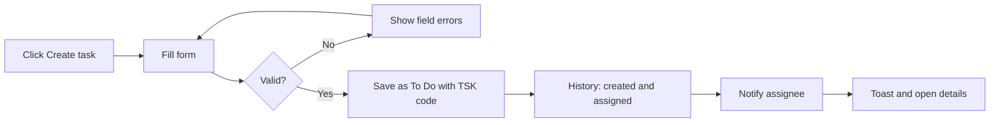

# Functional Requirements Document – Task Management

## TaskFlow – Intelligent Task Allocation & Tracking System

> **Document:** Functional Requirements Document (sub-module 02.1 Task Management, code `TASK`)  ·  **Version:** 1.0  ·  **Status:** Draft
> **Project type:** Personal Project (Skill Development)  ·  **Date:** 31-Oct-2026
> **Author:** Jojo George (jojogeorge3344@gmail.com)
> **Based on:** BRD-Task-Management.md v1.0
> © 2026 Jojo George. All rights reserved.

---

## Document Control

### Revision History

| Version | Date | Author | Summary of changes |
|---|---|---|---|
| 1.0 | 31-Oct-2026 | Jojo George | Initial version, derived from BRD-Task-Management v1.0 and the verified Task Management and Comments & Activity History workflow docs |

### Related Documents

| Document | Purpose | Location |
|---|---|---|
| BRD – Task Management | Business needs this FRD details (`REQ-TASK-nn`, `BR-TASK-nn`) | `../../../BRD/02-TaskFlow-Monitoring/02.1-Task-Management/BRD-Task-Management.md` |
| Overall BRD / FRD | Roles, global rules `BR-nn`, global NFRs, Authentication and Legal | `../../../BRD/00-Overall/BRD-TaskFlow-Overall.md`, `../../00-Overall/FRD-TaskFlow-Overall.md` |
| Sibling FRDs – Employee Workload, Board | Screens that open or share task data | `../02.2-Employee-Workload/FRD-Employee-Workload.md`, `../02.3-Board/FRD-Board.md` |
| Development Plan | Screen-wise build plan (original Screens 7, 8, 9, 11, 15, 18) | `TF - Documents/Screens Wise Feature Development Plan/` |
| HLD / LLD / TDD | Technical design | `../../../HLD/02-TaskFlow-Monitoring/02.1-Task-Management/HLD-Task-Management.md`, `../../../LLD/02-TaskFlow-Monitoring/02.1-Task-Management/LLD-Task-Management.md`, `TDD-TaskFlow.md` (v2.0) |

---

## 1. Introduction

### 1.1 Purpose
This FRD specifies the detailed, testable behaviour of the Task Management sub-module of TaskFlow Monitoring: the Task
List, Create Task (including Copy), Task Details, Reassign Task, Task Discussion and Activity History screens. For each
screen it states the inputs, outputs, rules, validations, messages and permissions, and traces every requirement back
to the Task Management BRD.

### 1.2 Scope
In scope: the six screens above and the behaviour behind them (task scope, status rules, worked hours, soft delete,
comments, activity history and the notifications and internal mail these actions send).

Out of scope (see BRD §3.2): choosing an initial status on Create; editing reminder intervals after creation; a screen
for changing additional recipients after creation; the Board (`../02.3-Board/FRD-Board.md`); Employee Workload
(`../02.2-Employee-Workload/FRD-Employee-Workload.md`); sending deadline reminders (Notification,
`../../04-Communication/04.2-Notification/FRD-Notification.md`); task reports (`../../05-Reports/05.1-Reports/FRD-Reports.md`).

### 1.3 Audience
Developer, tester and reviewer of TaskFlow (Jojo George), and the product owner approving the behaviour.

## 4. Functional Requirements by Module

### 4.1 Module: Task Management (TASK)

**Purpose:** Keep one reliable record per task – owner, deadline, status, effort, discussion and history – and let
authorised users act on it.  ·  **BRD reference:** BRD-Task-Management §5 SCREENS 1–6, BR-TASK-01…12; global BR-06…BR-13, BR-17…BR-19, BR-21…BR-23.

#### 4.1.2 Screen: Create Task (and Copy Task)

| Field | Value |
|---|---|
| Route / location | `/tasks/new`; Copy opens `/tasks/new?copyFrom={id}` |
| Access | `tasks.create` (Administrator, Manager; Custom role as granted). Also needs `employees.view`, `projects.view` and `settings.reminders.manage` to fill the drop-downs and defaults |
| Entry points | Task List **Create task**; **Copy task** on a list row; **Copy** on Task Details |

**Screen elements**

| Element | Type | Description | Mandatory | Visible to |
|---|---|---|:---:|---|
| Project | Drop-down | Active projects | Yes | `tasks.create` |
| Title | Text input | Up to 200 characters | Yes | `tasks.create` |
| Description | Text area | Up to 4000 characters | No | `tasks.create` |
| Assigned employee | Drop-down | Active users with the Employee role | Yes | `tasks.create` |
| Priority | Selector | Low, Medium, High, Critical; default from Application Settings | Yes | `tasks.create` |
| Start date, Deadline | Date-time inputs | Default now and now + 3 days | Yes | `tasks.create` |
| Estimated hours | Number input | Greater than 0 | Yes | `tasks.create` |
| Additional recipients | Checklist | Active users except the assignee; hint "The assigned employee is always notified." | No | `tasks.create` |
| First reminder, Second reminder | Number inputs | Days before the deadline (0–30), prefilled from Reminder Settings | No | `tasks.create` |
| After the deadline | Selector | Daily / Weekly, prefilled from Reminder Settings | No | `tasks.create` |
| Copy notice | Notice | "Copied from TSK-…. Check the dates before creating." | – | When opened with Copy |
| Cancel, Create task | Buttons | Leave without saving / save the task | – | `tasks.create` |

**Functional requirements**

| ID | Requirement | Priority | Permission | BRD trace |
|---|---|---|---|---|
| FR-TASK-14 | The system shall give every new task a unique, never-reused code `TSK-` followed by the 6-digit task number (e.g. `TSK-000042`). | Must | `tasks.create` | REQ-TASK-11, BR-07 |
| FR-TASK-15 | The system shall require Project, Title, Assigned employee, Priority, Start date, Deadline and Estimated hours. | Must | `tasks.create` | REQ-TASK-12, BR-08 |
| FR-TASK-16 | The system shall reject a Title longer than 200 characters and a Description longer than 4000 characters. | Must | `tasks.create` | REQ-TASK-13 |
| FR-TASK-17 | The system shall offer the priorities Low, Medium, High and Critical and preselect the default priority from Application Settings. | Must | `tasks.create` | REQ-TASK-14 |
| FR-TASK-18 | The system shall preset Start date to the current date and time and Deadline to three days later. | Should | `tasks.create` | REQ-TASK-15 |
| FR-TASK-19 | The system shall reject a Deadline that is not later than the Start date. | Must | `tasks.create` | REQ-TASK-16, BR-08 |
| FR-TASK-20 | The system shall reject Estimated hours that are not greater than 0. | Must | `tasks.create` | REQ-TASK-17, BR-08 |
| FR-TASK-21 | The system shall save every new task with status To Do; the form has no status field. | Must | `tasks.create` | REQ-TASK-18, BR-11 |
| FR-TASK-22 | The system shall always add the assignee as a recipient, accept up to 50 additional recipients chosen from active users, and reject the task if any recipient does not exist. | Must | `tasks.create` | REQ-TASK-19, BR-TASK-05, BR-09 |
| FR-TASK-23 | The system shall accept First and Second reminder values of 0 to 30 days before the deadline (0 = deadline day) and an overdue frequency of Daily or Weekly, reject a second reminder that comes before the first, and use the Reminder Settings defaults for empty fields. | Must | `tasks.create` | REQ-TASK-20, BR-TASK-06, BR-14 |
| FR-TASK-24 | The system shall accept only an assignee who exists and is active and a project that exists and is active. | Must | `tasks.create` | REQ-TASK-21, BR-08 |
| FR-TASK-25 | The system shall list only active users with the Employee role in the Assigned employee drop-down. | Must | `tasks.create`, `employees.view` | REQ-TASK-22 |
| FR-TASK-26 | The system shall record the creator and creation time and add the history entries "Task created" and "Assigned to {name}". | Must | `tasks.create` | REQ-TASK-23, BR-19 |
| FR-TASK-27 | The system shall notify the assignee in-app with "A task was assigned to you: {title}" as part of saving the task. | Must | `tasks.create` | REQ-TASK-24, BR-09 |
| FR-TASK-28 | The system shall, after saving, show "{code} created and assigned to {name}" and open the new task's details. | Should | `tasks.create` | REQ-TASK-11, REQ-TASK-24 |
| FR-TASK-29 | The system shall, when **Copy** is used, prefill the form from the source task (keeping the new-task date defaults), show "Copied from TSK-…. Check the dates before creating.", and save nothing until the user clicks **Create task**. | Should | `tasks.create` | REQ-TASK-25 |
| FR-TASK-30 | The system shall show "Copied from TSK-…, but {name} can no longer be assigned. Choose another employee." when the source assignee cannot be chosen, and "That task could not be copied, so the form is empty." when the source task cannot be loaded. | Should | `tasks.create` | REQ-TASK-25 |

**Use case: UC-TASK-03 – Create and assign a task**

| Item | Detail |
|---|---|
| Actor | Manager or Administrator |
| Preconditions | Signed in; holds `tasks.create` (and the supporting view keys) |
| Trigger | Clicks **Create task** on the Task List |
| Main flow | 1. System opens the form with the default priority, start now, deadline now + 3 days and the reminder defaults. 2. User picks Project, enters Title, picks Assigned employee, Priority, dates and Estimated hours, and optionally recipients and reminders. 3. User clicks **Create task**. 4. System validates the form and the server rules. 5. System saves the task as To Do with a `TSK-` code and adds the assignee as a recipient. 6. System records "Task created" and "Assigned to {name}" and notifies the assignee. 7. System shows "{code} created and assigned to {name}" and opens Task Details. |
| Alternate flows | A1: **Cancel** – nothing is saved. |
| Exceptions | E1: Missing or invalid field → field message (see validations); nothing saved. E2: Assignee or project inactive → "The assigned employee does not exist or is not active." / "The selected project does not exist." E3: No permission → "Your role is not allowed to create tasks."; without `tasks.create` the route sends the user back to the dashboard. |
| Postconditions | Task saved as To Do; assignee notified; history started; task visible to authorised users |

**Use case: UC-TASK-04 – Copy a task**

| Item | Detail |
|---|---|
| Actor | Manager or Administrator |
| Preconditions | Holds `tasks.create`; can access the source task |
| Trigger | Clicks **Copy task** on a list row or **Copy** on Task Details |
| Main flow | 1. System opens Create Task filled from the source task, with new-task dates. 2. System shows "Copied from TSK-…. Check the dates before creating." 3. User adjusts the values and continues as UC-TASK-03 from step 3. |
| Alternate flows | A1: Source assignee can no longer be assigned → warning naming the person; user chooses another employee. |
| Exceptions | E1: Source cannot be loaded → "That task could not be copied, so the form is empty." |
| Postconditions | A new, independent task (the source is unchanged) |

**Field validations**

| Field | Rule | Error message |
|---|---|---|
| Project | Required; must exist and be active | "Project is required." · "The selected project does not exist." |
| Title | Required; at most 200 characters | "Title is required." · "Title must be 200 characters or fewer." |
| Description | At most 4000 characters | "Description must be 4000 characters or fewer." |
| Assigned employee | Required; must exist and be active | "Select the employee to assign." · "The assigned employee does not exist or is not active." |
| Start date | Required | "Start date is required." |
| Deadline | Required; later than Start date | "Deadline is required." · "Deadline must be after the start date." |
| Estimated hours | Required; greater than 0 | "Estimated hours are required." · "Estimated hours must be a positive number." |
| Additional recipients | At most 50; every user must exist | "A task can have at most 50 additional recipients." · "One or more recipients do not exist." |
| First / Second reminder | 0–30 days; second not before first | "The second reminder cannot come before the first reminder." |

**Business rules applied:** BR-TASK-05, BR-TASK-06, BR-TASK-12; global BR-07, BR-08, BR-09, BR-10, BR-11, BR-14, BR-19.

**Notifications / side effects**

| Event | Who is notified | Channel |
|---|---|---|
| Task created and assigned (N-TASK-01) | Assignee | In-app |
| Reminder intervals stored | Used later by the reminder engine for the recipients and creator | In-app and Mail (Notification sub-module) |

**Messages**

| Situation | Message |
|---|---|
| Success | "TSK-000123 created and assigned to {name}" |
| No permission | "Your role is not allowed to create tasks." |
| Copy notice | "Copied from TSK-…. Check the dates before creating." |

## 12. Approvals

| Role | Name | Decision | Date |
|---|---|---|---|
| Product owner | Jojo George | Pending | – |
| Reviewer | Jojo George | Pending | – |

---
© 2026 Jojo George. All rights reserved. Unauthorized copying or distribution of this document is prohibited.
